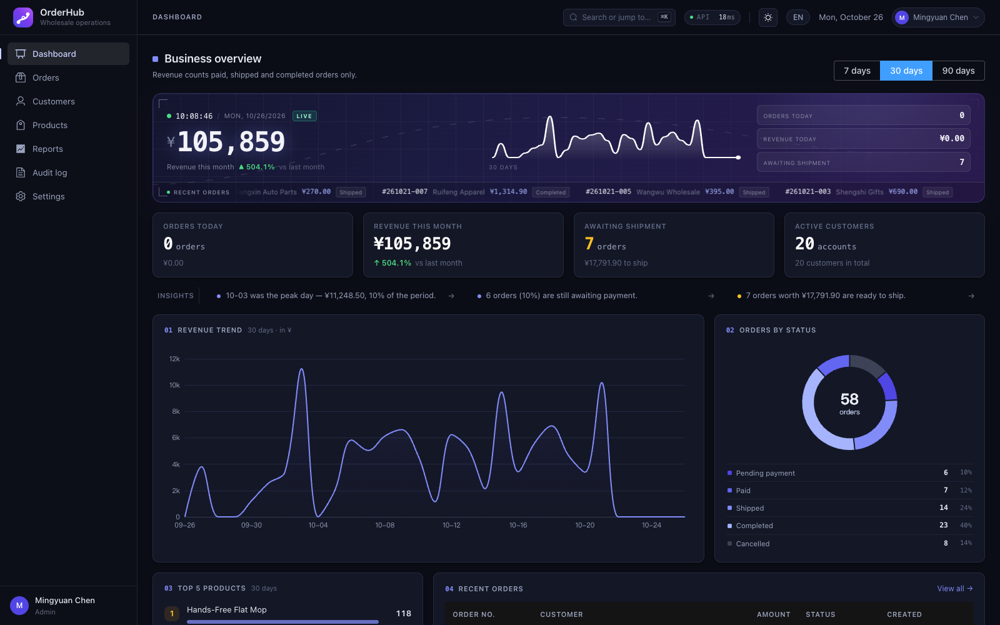
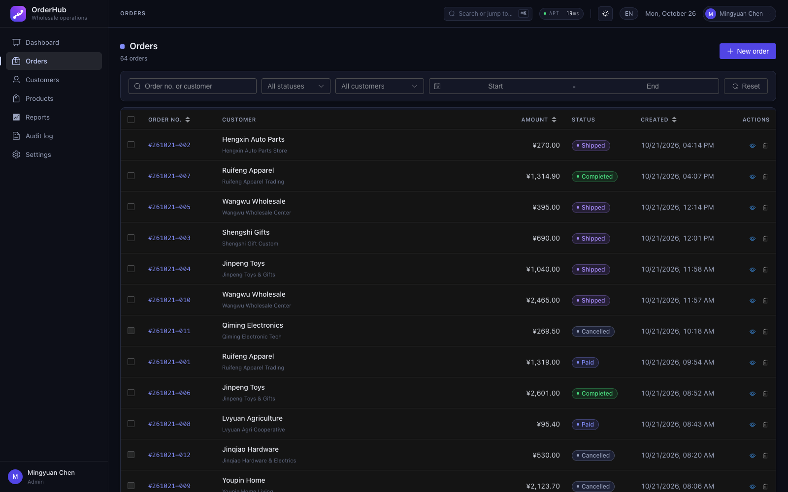
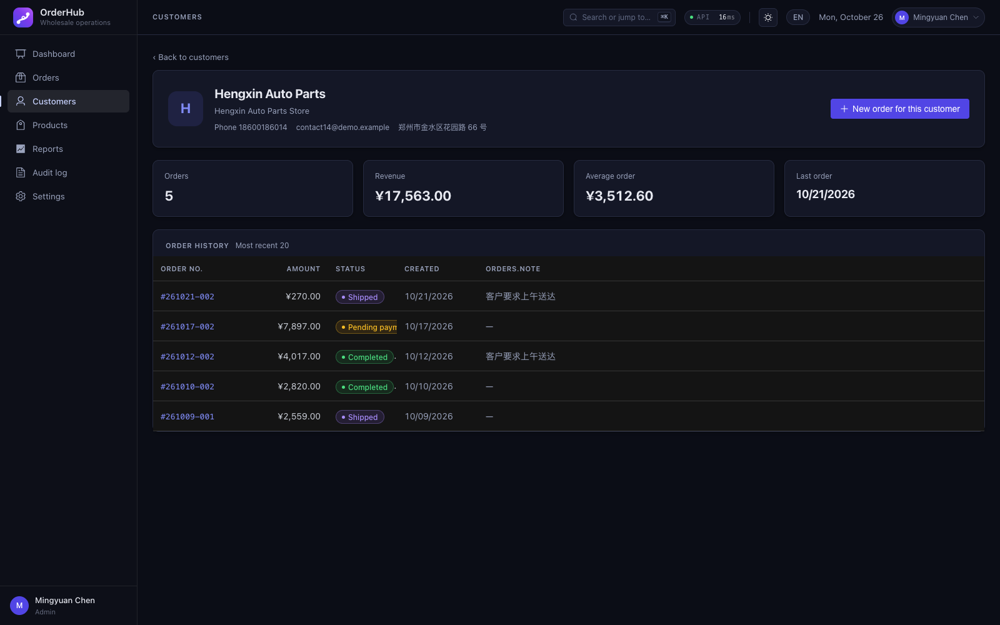
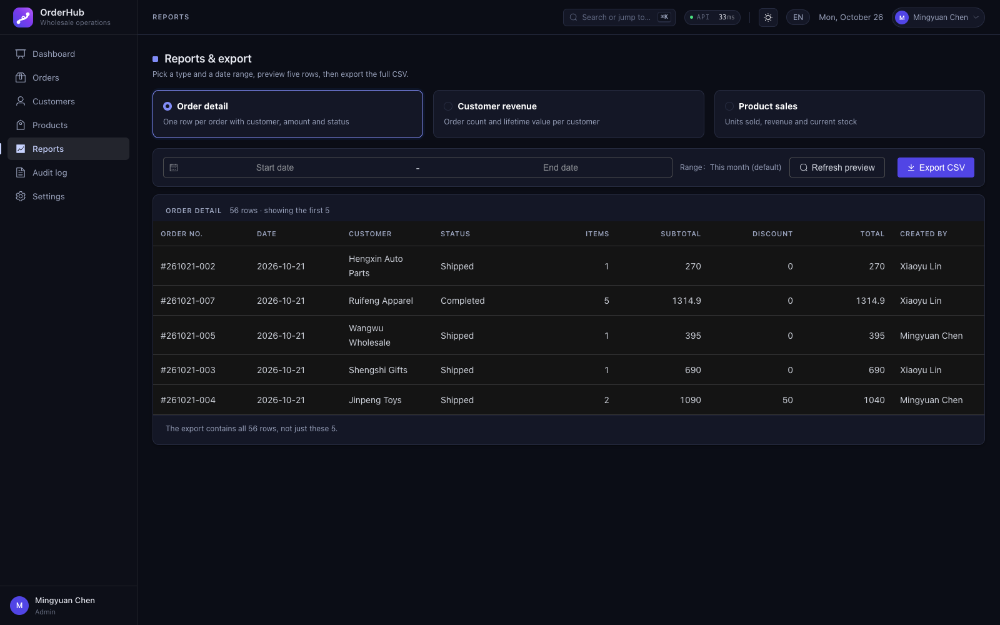
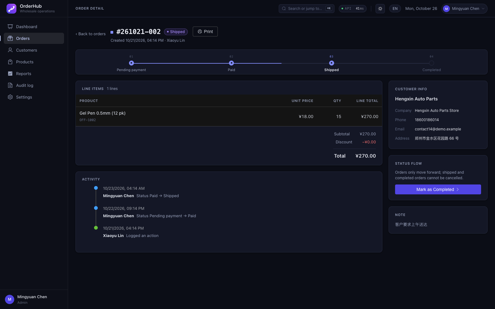
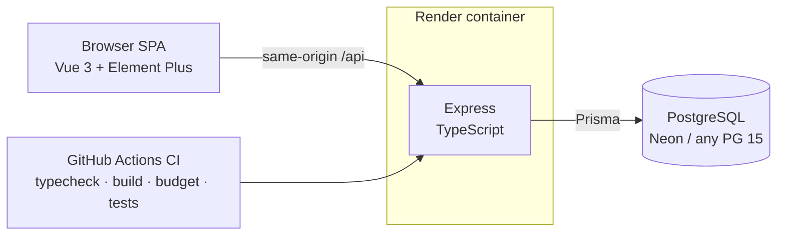

# OrderHub

[](https://github.com/hezg14/orderhub/actions/workflows/ci.yml)


**Order, customer, and inventory management for small wholesale & trading companies — the Excel-replacement back office.**

Vue 3 + TypeScript · Express + Prisma + PostgreSQL · one Docker container serves the whole stack.



## Try it

| Role | Email | Password | What you'll see |
|---|---|---|---|
| Owner (admin) | `admin@orderhub.demo` | `Demo1234` | Everything: reports, audit trail, deletes, credit control |
| Staff | `staff@orderhub.demo` | `Demo1234` | Same UI minus owner-only pages; destructive buttons disabled and API-protected |

> Demo data resets on every container boot, so the numbers are always self-consistent for a reviewer.
> The seeded book includes one customer deliberately placed ¥500 under their credit ceiling — the next order for that account trips the credit-limit guard on screen.

## Why this isn't a CRUD sample

| | |
|---|---|
| **Credit control** | Wholesale lives on open credit. Creating an order locks the customer row (`SELECT … FOR UPDATE`), sums their unsettled orders inside the same transaction as the stock locks, and rejects the order with a full breakdown (limit / receivable / shortfall) if it would push them over. Concurrent orders cannot both "fit" the limit. |
| **Anti-oversell, proven** | Row locks in `id` order (deadlock-safe), duplicate lines merged, stock decremented in-transaction. An integration test races 8 concurrent requests for the last unit — exactly 1 order succeeds, stock never goes negative. |
| **Idempotent order creation** | `Idempotency-Key` header: the key commits atomically with the order it produced; retries get the original order back (`Idempotent-Replay: true`) instead of a duplicate. Scoped to the owner — a leaked key gets a stranger a 409, not your data. |
| **Accounts-receivable aging** | 30/60/90-day AR buckets per customer, admin-only report, visualized as a stacked aging bar. |
| **Audit trail** | Field-level `from → to` diffs with request IDs on every write, including role changes and credit-limit edits. |
| **RBAC done end-to-end** | JWT in an httpOnly cookie, role re-read from the DB on every request (downgrades take effect immediately), route- and service-level checks, permission matrix page. Staff hitting an owner-only API gets 403 — not a hidden button. |
| **Bilingual & responsive** | zh/en with a dictionary key-parity test; lists collapse to cards under 768px; 3-viewport UI audit with zero horizontal overflow. |

## Screenshots

| | |
|---|---|
|  |  |
|  |  |

## Architecture



- **One container**: Express serves the built SPA and the API on the same origin — no CORS in production, one thing to deploy.
- **Migrations on boot**: `prisma migrate deploy` runs in the entrypoint; the app refuses to start without a 32+ char `JWT_SECRET`.
- **Budgeted frontend**: per-route code splitting; ECharts and Element Plus are separate chunks; CI fails if gzipped JS exceeds 520 KB.

## Tech choices (and what was rejected)

| Layer | Choice | Why | Rejected |
|---|---|---|---|
| Frontend | Vue 3.5 + Vite 5 | table/form-dense admin; Element Plus ships the components this needs | React — fine, but ~800 more lines of bespoke table/drawer glue |
| State | Pinia (session only) | page data lives in components | storing page data in a store — cache invalidation for nothing |
| Backend | Node 20 + Express + TS | one language across the stack, minimal handover cost | NestJS — boilerplate at this size |
| ORM | Prisma 5 | typed queries, reviewable SQL migrations | raw SQL everywhere; TypeORM decorator noise |
| Database | PostgreSQL 15 | real row-level locks — the anti-oversell story needs them | SQLite (no concurrent writers) |
| Validation | Zod | one schema → runtime check + TS type | Joi (no type inference) |
| Auth | JWT in httpOnly cookie | unreadable by XSS; SameSite=Lax | localStorage tokens |

## Run it locally

```bash
# A) Docker (backend + database)
docker compose up -d --build          # migrates on first boot
cd backend && npm install && cp .env.example .env && npm run db:seed

# B) Plain Node (bring your own Postgres 15)
cd backend && cp .env.example .env    # DATABASE_URL, JWT_SECRET (32+ chars)
npm install && npx prisma migrate deploy && npm run db:seed && npm run dev

# Frontend (both paths)
cd frontend && npm install && npm run dev   # http://localhost:5173
```

## Notable implementation details

**Order numbers under concurrency** — `count(*) + 1` collides the moment two orders race. A transaction-scoped advisory lock serializes read-max → increment → write, and needs no extra table:

```ts
await tx.$executeRaw`SELECT pg_advisory_xact_lock(hashtext(${'order_no:' + prefix}))`;
```

**Anti-oversell** — three things, all required: row locks (not check-then-decrement), a fixed lock order, and merged duplicate lines:

```ts
const products = await tx.$queryRaw`
  SELECT id, stock, unit_price, name FROM products
  WHERE id = ANY(${productIds}::uuid[])
  ORDER BY id          -- fixed lock order: no cross-order deadlocks
  FOR UPDATE`;
```

**State machine, single source** — transitions live in one pure module; the same table is served to the UI so buttons and API never disagree. Illegal transitions return 422 with the allowed next states.

**CSV that survives Excel** — UTF-8 BOM so Chinese renders, plus formula-injection guarding (`=HYPERLINK(...)` in a customer name becomes a literal cell, not an executed formula).

## Testing & verification

```bash
cd backend  && npx tsc --noEmit && npm test        # unit (state machine, CSV, i18n-safe helpers)
                                                    # + integration on real PG (concurrency, idempotency, credit)
cd frontend && npm run typecheck && npm run build && npm run size   # bundle budget gate
```

56 tests total, including integration tests that boot the real Express app against real PostgreSQL. `docs/VERIFICATION.md` holds the full latest verification matrix.

## Deploy

[](https://render.com/deploy?repo=https://github.com/hezg14/orderhub)

One Render free web service (this repo's Blueprint) + one Neon free Postgres. The Blueprint asks for `DATABASE_URL` and generates `JWT_SECRET`; `SEED_ON_BOOT=true` resets demo data on each deploy/restart. The free tier sleeps after 15 idle minutes — first visit wakes in ~30–60 s.

## Known limitations

Stated, not hidden: login rate limiting is in-process (multi-instance needs Redis); no E2E suite yet; order numbers reset per server-local day; no soft delete (audit rows outlive their entities). All tracked with next steps in the README history and `docs/VERIFICATION.md`.

---

*Fictional product built as a portfolio piece. Seed data is fully synthetic.*
